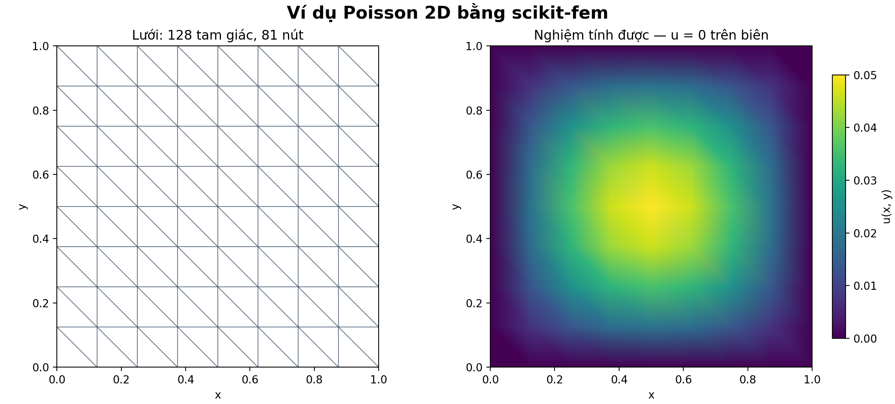

# Ví dụ Poisson bằng scikit-fem

Đã chạy và kiểm tra trên Windows bằng VS Code với Python 3.12.8
và scikit-fem 12.0.2. Các kiểm tra trong chương trình đều đạt
(`checks_passed: true` trong `results.json`).
Ví dụ dựa theo hướng dẫn chính thức:
https://scikit-fem.readthedocs.io/en/stable/gettingstarted.html

## Bài toán

Giải -Δu = sin(πx) sin(πy) trên hình vuông (0,1) × (0,1),
với u = 0 trên toàn bộ biên. Trong ví dụ này, u là một hàm vô hướng.

Nghiệm chính xác là u(x,y) = sin(πx) sin(πy)/(2π²).
Các tọa độ và đại lượng của bài toán mẫu không gán đơn vị vật lý.

Phần tử sử dụng: tam giác P1, tức hàm tuyến tính trên từng tam giác.
Lưới chính theo tài liệu có 128 tam giác và 81 nút.

## Kết quả đã chạy



| Mức chia lưới | Số tam giác | Số nút | Sai số L2 | Sai số L2 tương đối |
|---|---:|---:|---:|---:|
| 3 | 128 | 81 | 1.0339569 × 10⁻³ | 4.08190% |
| 4 | 512 | 289 | 2.6347844 × 10⁻⁴ | 1.04017% |
| 5 | 2048 | 1089 | 6.6191702 × 10⁻⁵ | 0.26131% |

L2 đo sai số trên toàn miền, có tính đến diện tích của các phần tử.
Các tích phân sai số được tính bằng phép tích phân số của thư viện.

Giá trị 1.069e-6 trong tài liệu là tích phân của bình phương sai số,
tức bình phương chuẩn L2. Chương trình tái hiện giá trị này:
≈ 1.0690668198615e-6. Lấy căn bậc hai được sai số L2 ≈ 0.0010339569.
Sai số L2 tương đối bằng sai số L2 chia cho chuẩn L2 của nghiệm đúng;
chuẩn của nghiệm đúng trong bài này bằng 1/(4π²).

Điều kiện u = 0 được thỏa mãn tại mọi nút biên. Phần dư tương đối
của hệ tuyến tính tại các ẩn tự do từ khoảng 10⁻¹⁵ đến 10⁻¹⁴.
Sai số L2 giảm khoảng 4 lần khi mỗi cạnh lưới được chia đôi.

## Các tệp

- `poisson_demo.py`: code có chú thích tiếng Việt; giải và kiểm tra ba mức lưới.
- `requirements.txt`: các phiên bản thư viện chính đã dùng.
- `Ket_qua_Poisson.png`: lưới và nghiệm tính được ở mức 3.
- `results.json`: thông số chạy, kết quả sai số và kiểm tra.
- `mesh_convergence.csv`: kết quả ba mức lưới.
- `nodal_solution.csv`: tọa độ, nghiệm số, nghiệm đúng và sai lệch tại 81 nút.

## Chạy lại trên Windows khi đã có Python

Mở CMD trong thư mục đã giải nén và chạy lần lượt:

```bat
python -m venv .venv
.venv\Scripts\activate.bat
python -m pip install -r requirements.txt
python poisson_demo.py
```

Script lưu kết quả ngay trong thư mục chứa nó, ghi đè các tệp kết quả
cùng tên khi chạy lại. Bản chạy cloud không cài Python vào máy Windows.

## Chạy trong VS Code

Mở thư mục `Poisson_scikit_fem` (thư mục có `poisson_demo.py`).
Cấu hình trong `.vscode` sử dụng Python của môi trường `.venv` tại đây.
Sau khi cài thư viện theo các lệnh trên và cài extension Python của Microsoft:

1. Nếu VS Code hiện **Restricted Mode**, tự xác nhận tin cậy thư mục project.
2. Nhấn **F5**, chọn **Chạy ví dụ Poisson** nếu được hỏi.
3. Xem thông số và `checks_passed: true` trong **Debug Console**.
4. Mở `Ket_qua_Poisson.png` trong Explorer để xem hình lưới và nghiệm.

Mỗi lần chạy sẽ cập nhật ảnh, `results.json` và hai tệp CSV cùng thư mục.

## Liên hệ với khóa luận

Bài này minh họa quy trình dựng miền, chia lưới, viết phương trình,
đặt điều kiện biên, giải hệ và kiểm chứng bằng nghiệm đúng. Mô hình
bộ trộn điện thẩm còn cần hình học, bài toán điện thế, dòng chảy,
vận chuyển chất tan và điều kiện biên riêng theo bài báo.

Code giữ các bước giải của hướng dẫn và bổ sung lưu ảnh, dữ liệu,
kiểm tra điều kiện biên, phần dư hệ tuyến tính và hội tụ theo lưới.
